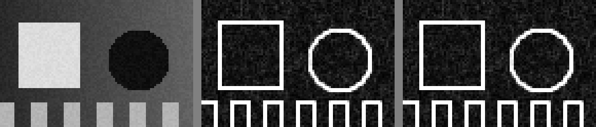

# FPGA Accelerator: from a MAC unit to a systolic convolution engine

Verilog for a small image-processing accelerator on a Xilinx Virtex-6 (ML605 board, XC6VLX240T),
built and measured one step at a time. Each stage changes one thing, then checks it with a
self-checking testbench and an XST synthesis run to see what the change did to speed and size.

The Sobel engine streams pixels in one per clock (like a camera link), keeps only two image rows in
a block-RAM line buffer, and outputs the edge strength `|Gx| + |Gy|` for every pixel with a full
3x3 neighbourhood. It was built as the FPGA side of an FPGA-vs-GPU comparison for a real-time
video pipeline.



*Left: 96x64 test image. Middle: edges from the Python golden model. Right: edges produced by the
Verilog in simulation (Stage 2b). All 5,828 output pixels match.*

## Results

All numbers are XST synthesis estimates (ISE 14.7, xc6vlx240t-1-ff1156, `IMG_W = 640`), before
place-and-route. Every stage passes its testbench.

### Stage 1 baseline and Stage 2a: pipelined MAC

Stage 1 is a signed int8 multiply-accumulate unit (`rtl/1_mac/mac.v`): a 16-bit signed product and
a 32-bit accumulator with synchronous reset, enable, and a `clr` that starts a new dot product on
the same clock. XST maps the whole thing into a single DSP48E1 ("8x8-to-32-bit Loadable MAC").
Stage 2a registers the product so the multiply and the add happen on different clocks.

| | Stage 1 `mac` | Stage 2a `mac_p` |
|---|---|---|
| DSP48E1s | 1 | 1 |
| Slowest path | input → multiply → add → acc, 4.09 ns | `clr_r` → INV → DSP OPMODE, 3.18 ns |
| Est. clock | ≈245 MHz | ≈314 MHz |
| Latency | 1 clock | 2 clocks |
| Simulation | PASS (1,879 vectors) | PASS (1,879 vectors) |

### Stages 2b–2e: Sobel edge detector

| | 2b | 2c | 2d | 2e |
|---|---|---|---|---|
| Change | first version | pipelined adder tree | + pipelined magnitude | fixed Sobel kernel |
| Kernel | programmable | programmable | programmable | **fixed** |
| DSP48E1s | 18 | 18 | 18 | **0** |
| Block RAM (RAMB18) | 1 | 1 | 1 | 1 |
| Slice LUTs | 110 | 206 | 255 | 227 |
| Slice registers | 124 | 165 | 206 | 248 |
| Slowest path | 7-DSP cascade | magnitude (17 logic levels) | one DSP→DSP hop | BRAM read → BRAM write |
| Period | 13.80 ns | 4.05 ns | 3.70 ns | 2.74 ns |
| **Est. clock** | **72 MHz** | **247 MHz** | **270 MHz** | **365 MHz** |
| Latency (clocks) | 5 | 6 | 7 | 6 |
| Simulation | PASS 5828 | PASS 5828 | PASS 5828 | PASS 5828 |

Throughput is one pixel per clock in every stage. 640x480 at 30 fps needs about 9.2 Mpixel/s, so
even the slowest version has about 7x headroom and the fastest about 40x.

Report excerpts with the critical paths are in [`results/synthesis/`](results/synthesis).

### What each step showed

- **2a**: Registering the product lets XST use the DSP48E1's internal multiplier register (MREG):
  ≈245 → ≈314 MHz for one extra clock of latency. The slowest path moved to a control signal.
- **2b**: Summing all 9 products in one clock made XST chain 8 DSPs through their cascade ports
  (PCOUT → PCIN). Correct, but 13.8 ns per clock.
- **2c**: Adding each window row first, then the three row sums, cut the chain to short per-row
  hops: 72 → 247 MHz. The slowest path moved to the magnitude logic.
- **2d**: Splitting the magnitude (absolute values, then add and clamp) helped less: 247 → 270 MHz.
  The limit is now a single hop between two DSPs. Going further needs a systolic DSP chain
  (every DSP registered, inputs delayed to match).
- **2e**: Building Sobel's coefficients (0, ±1, ±2) into the arithmetic removes every multiplier:
  18 → 0 DSPs and 365 MHz. The slowest path is now the line-buffer block RAM, not the arithmetic.
  The catch: this version can only ever compute Sobel. A CNN layer needs changeable weights,
  which is why a general accelerator keeps the programmable engine.

### Stage 3a: systolic convolution engine

`conv3x3_sys` does the same job as `conv3x3` (programmable 3x3 kernel, one window per clock), but as
a **systolic chain**: every tap stores its partial sum in its DSP's P register, and the next tap adds
its product to that stored value on the next clock (`P_i <= P_(i-1) + x_i * w_i`). Because the
partial sum reaches tap *i* exactly *i* clocks after tap 0, pixel *i* is delayed by *i* clocks too
(the "skew" delay line in each tap), the same structure as a TPU-style systolic array.

| | 2d (programmable) | 2e (fixed) | **3a (programmable, systolic)** |
|---|---|---|---|
| DSP48E1s | 18 | 0 | 18 |
| Slice LUTs (incl. SRLs) | 255 | 227 | 239 (86 SRLs) |
| Slice registers | 206 | 248 | 278 |
| Slowest path | DSP→DSP hop (two adds) | BRAM read → write | magnitude add/clamp (fabric) |
| Period | 3.70 ns | 2.74 ns | 3.05 ns |
| **Est. clock** | **270 MHz** | **365 MHz** | **328 MHz** |
| Latency (clocks) | 7 | 6 | 15 |
| Simulation | PASS 5828 | PASS 5828 | PASS 5828 + unit test PASS 7500 |

- Every DSP now runs with its multiplier and output registers on (XST: "registers also absorbed by
  the MAC: `m_r`, `pout`"), and the slowest path is no longer anywhere in the DSP chain. The
  programmable engine is within ~10% of the fixed Sobel's clock.
- Gx and Gy delay the same pixels, so XST merged their skew delay lines: the whole skew costs
  48 SRLs.
- `tb_conv_sys` (no data files) runs 25 coefficient sets × 300 random windows, with a different
  coefficient in every tap. Planted bugs were all caught; a wrong delay on the centre tap passes the
  Sobel test (its coefficient is 0 in both kernels) but fails the unit test.
- Coefficients must only change while the engine is idle (each tap samples its coefficient at a
  different time). Stage 3b loads weights properly.

## Repository layout

```
rtl/
  1_mac/                    mac.v                       Stage 1 baseline: int8 multiply-accumulate
  2a_pipelined_mac/         mac_p.v                     pipelined multiply-accumulate
  2b_sobel/                 sobel.v, conv3x3.v          first Sobel: line buffer, 3x3 window, 2 x conv3x3
  2c_pipelined_adder/       sobel.v, conv3x3.v          adder tree split over two clocks
  2d_pipelined_magnitude/   sobel.v, conv3x3.v          magnitude split over two clocks
  2e_constant_kernel/       sobel.v, sobel_kernel.v     fixed Sobel, no multipliers
  3a_systolic/              sobel.v, conv3x3_sys.v      programmable systolic 3x3 engine
sim/
  tb_mac.v, tb_mac_p.v, vectors.txt                     testbenches + shared test vectors for 1 and 2a
  tb_sobel.v, image.hex, expected.txt                   testbench + test image + golden results for 2b-3a
  tb_conv_sys.v                                         unit testbench for conv3x3_sys (no data files)
scripts/
  gen_vectors.py            golden model for the MAC, writes vectors.txt
  gen_sobel.py              test image + golden Sobel model, writes image.hex / expected.txt
  show_result.py            turns the simulator's sim_out.hex into a PNG
  png_util.py               tiny PNG writer (no dependencies)
results/
  synthesis/                XST report excerpts for every stage
  images/                   input, expected and hardware edge images
  sim_out_2b.hex            raw output of the Stage 2b simulation
```

The same `tb_sobel.v` tests all five Sobel stages. It follows `out_valid`, so it doesn't depend on
the pipeline latency (it waits 30 clocks at the end, enough for 3a's 15-clock pipeline), and it
randomly skips about 25% of input clocks to check that every valid flag stays aligned with its data.

## Running it

### Xilinx ISE 14.7 / ISim

1. New project: Virtex-6, xc6vlx240t, ff1156, speed -1, XST, ISim, Verilog.
2. Add the stage's `rtl/` files (association **All**) and the testbench from `sim/` (association
   **Simulation**). Copy the data files (`image.hex` and `expected.txt`, or `vectors.txt` for 2a)
   into the project folder; they don't need to be added to the project.
3. Simulation view → select the testbench → Simulate Behavioral Model → `run all`. Expect:
   - 1: `PASS: 1879 cycles matched the golden model`
   - 2a: `PASS: 1879 vectors matched the golden model (latency 2)`
   - 2b–3a: `PASS: 5828 edge pixels matched the golden model`
   - 3a unit test (`tb_conv_sys`): `PASS: 7500 windows matched the reference (latency 11)`
4. Implementation view → top = `mac`, `mac_p` or `sobel` → Synthesize - XST.

### Icarus Verilog (no Xilinx tools needed)

From the `sim/` folder, for example Stage 3a:

```
iverilog -o sobel_sim tb_sobel.v ../rtl/3a_systolic/sobel.v ../rtl/3a_systolic/conv3x3_sys.v
vvp sobel_sim
iverilog -o conv_sim tb_conv_sys.v ../rtl/3a_systolic/conv3x3_sys.v
vvp conv_sim
```

### See the hardware's picture

The Sobel testbench writes `sim_out.hex`. From the folder that contains it:

```
python ../scripts/show_result.py
```

This writes `hardware.png`, which should look the same as `results/images/expected.png`.

### Regenerate the test data

```
cd sim
python ../scripts/gen_sobel.py      # image.hex, expected.txt (+ input.png, expected.png)
python ../scripts/gen_vectors.py    # vectors.txt for the MAC testbench
```

## Next

- **3b**: a conv-layer grid: several filters share one window, with weights loaded at runtime.
- **3c**: CNN-style output stage: bias, ReLU and requantization back to 8 bits.
